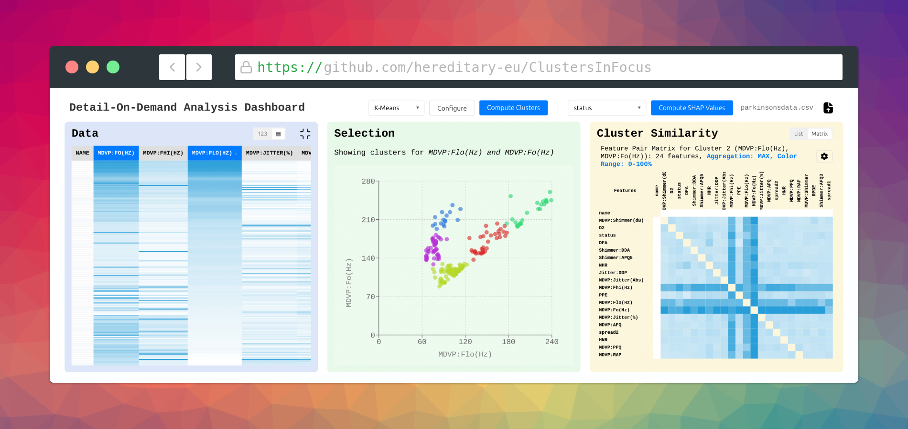

# Clusters in Focus

[](https://doi.org/10.2312/vcbm.20251250)
[](https://doi.org/10.5281/zenodo.17661296)
[](LICENSE)

Welcome to the code behind _Clusters in Focus: A Simple and Robust Detail-On-Demand Dashboard for Patient Data_, presented at EG [VCBM 2025](https://conferences.eg.org/vcbm2025/) at TU Delft.

[Demo](https://hereditary.cgv.tugraz.at/cif) · [Paper](https://diglib.eg.org/items/3d093c70-1cde-43a1-894b-d1ac41f22903) · [PDF](https://diglib.eg.org/server/api/core/bitstreams/3562c219-0d2c-49f7-bbef-d5c63fbe1a70/content)



> **Research use only. Not a medical device.** See [DISCLAIMER.md](DISCLAIMER.md) for intended use, data provenance and limitations.

## Overview

Exploring tabular datasets to understand how different feature pairs partition data into meaningful cohorts is crucial in domains such as biomarker discovery, yet comparing clusters across multiple feature pair projections is challenging.
We introduce _Clusters in Focus_, an interactive visual analytics dashboard designed to address this gap.

Clusters in Focus employs a three-panel coordinated view: a **Data Panel** offers multiple perspectives (tabular, heatmap, condensed with histograms / SHAP values) for initial data exploration; a **Selection Panel** displays the 2D clustering (K-Means / DBSCAN) for a user-selected feature pair; and a novel **Cluster Similarity Panel** featuring two switchable views for comparing clusters.
A ranked list enables the identification of top-matching feature pairs, while an interactive similarity matrix with reordering capabilities allows for the discovery of global structural patterns and groups of related features.
This dual-view design supports both focused querying and broad visual exploration.

A use case on a Parkinson's disease speech dataset demonstrates the tool's effectiveness in revealing relationships between different feature pairs characterizing the same patient subgroup.

## Data

The use case in the paper uses the Parkinson's disease voice measurement dataset by Max Little ([UCI Machine Learning Repository](https://doi.org/10.24432/C59C74), CC BY 4.0), as redistributed on [Kaggle](https://www.kaggle.com/datasets/debasisdotcom/parkinson-disease-detection/data).
It ships pre-loaded as `parkinsonsdata.csv` in `backend/app.db`.

You can upload your own CSV files through the interface. Uploaded datasets are stored in the server-side database and are visible to everyone using the same deployment, so **do not upload personal or patient data to the public demo**; self-host for anything that is not public.

## Running locally

```bash
docker compose build
docker compose up
```

This will start a webserver (on port 80), which you can access via your browser.
In order to recreate the screenshot above and in the paper (Figure 1), open Firefox on `http://localhost`.
You should now be able to see the interface.
On the top right dropdown, select `parkinsonsdata.csv`, which should already be available within the pre-loaded database.

You should now be able to see a tabular view of the data.
In order to get to the heatmap view, click on the list icon in the top-right corner of Panel 1 (the Data Panel).

Now for example, select the two columns `MDVP:FO(HZ)` and `MDVP:FLO(HZ)`.
Panel 2 should display a scatter plot of all entries within the dataset across these two features.

Click on one of the data points to open Panel 3 and you will be presented with a similarity analysis of all other possible clusters within the same dataset which share a high overlap of entries.
This similarity is based on the Jaccard Index $J \in [0, 1]$, which measures the overlap in data point membership

$$J = \frac{\left| C_{AB} \cap C_{XY:k} \right|}{\left| C_{AB} \cup C_{XY:k} \right|}.$$

You can switch between a list and matrix view, again on the top right.
The colored intensities there correspond to a high Jaccard Index, enabling a robust workflow for cluster re-identification.

## Citation

If you found this tool helpful for your work, please cite it as follows:

```bibtex
@inproceedings{2025-clusters-in-focus,
	booktitle = {VCBM 2025 - Eurographics Symposium on Visual Computing for Biology and Medicine},
	editor    = {Garrison, Laura and Krueger, Robert},
	title     = {{Clusters in Focus: A Simple and Robust Detail-On-Demand Dashboard for Patient Data}},
	author    = {Schilcher, Lukas and Waldert, Peter and Kantz, Benedikt and Schreck, Tobias},
	year      = {2025},
	publisher = {The Eurographics Association},
	issn      = {2070-5786},
	isbn      = {978-3-03868-276-9},
	doi       = {10.2312/vcbm.20251250}
}
```

## Acknowledgement

<picture>
  <source media="(prefers-color-scheme: dark)" srcset="figures/funded-by-the-eu-dark.png">
  
</picture>

Funded by the European Union under grant agreement No 101137074 ([HEREDITARY](https://hereditary-project.eu/)).
Views and opinions expressed are however those of the author(s) only and do not necessarily reflect those of the European Union or the European Health and Digital Executive Agency (HaDEA).
Neither the European Union nor the granting authority can be held responsible for them.

## License

MIT, see [LICENSE](LICENSE).
